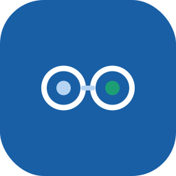

# Vinc — Website Oficial & Centro de Conhecimento

O **Vinc** é um website institucional e informativo, acompanhado de um completo **Centro de Conhecimento Antifraude Jurídica**. Desenvolvido sob rigorosos padrões de usabilidade (UX), acessibilidade (a11y) e otimização para motores de busca (SEO), o site apresenta a plataforma Vinc ao mercado e educa advogados, escritórios e clientes finais sobre prevenção de fraudes virtuais jurídicas.

> **Vinc — confirme antes de confiar.**

<div align="center">
  
  <p><em>A vitrine digital e central de educação preventiva da maior plataforma de blindagem contra engenharia social jurídica do país.</em></p>
</div>

<div align="center">


</div>

---

## 📖 Sobre o Site

O site do **Vinc** serve como o ponto de contato primário entre escritórios de advocacia, clientes e a segurança jurídica digital. No cenário atual, criminosos virtuais utilizam informações públicas de diários oficiais para ludibriar clientes que possuem processos na Justiça. O site do Vinc combate essa engenharia social fornecendo:

1.  **Páginas Institucionais:** Explicando de forma clara, técnica e transparente como funciona a barreira lógica e a validação criptográfica do sistema Vinc.
2.  **Educação Antifraude (Blog):** Um hub de artigos práticos e dinâmicos para desarmar táticas de falsificação de identidade (WhatsApp), boletos falsificados e desvios de Pix.

---

## 🎨 Identidade Visual e Filosofia de Design

A interface do site baseia-se no **minimalismo suíço moderno**, projetado com extremo rigor estético para transmitir autoridade, sobriedade e segurança técnica:

-   **Paleta de Cores de Alta Confiança**: Tons neutros profundos (carvão), fundos off-white sofisticados e acentos em **Azul Profundo** (`#2563eb`), que simboliza estabilidade institucional. O **Vermelho Carmim** (`#e11d48`) é reservado exclusivamente para sinalização de perigos e alertas.
-   **Tipografia Selecionada**: Títulos dinâmicos e modernos estilizados com fontes geométricas elegantes, pareados com metadados e marcadores em fontes monoespaçadas ("JetBrains Mono") para uma estética polida de tecnologia confiável.
-   **Zero Poluição Visual (Anti-AI-Slop)**: O design evita elementos falsificados, logs de carregamento de mentira, status de simulação ou gráficos que não entreguem valor real. Toda a tela reflete o valor de um produto de software real de alta segurança.

---

## 📁 Estrutura Completa do Projeto

O Vinc é um site **100% estático** (HTML5, CSS3 e JavaScript puro, sem build step, sem framework e sem dependências de Node.js):

```text
├── index.html                        # Página inicial (Landing Page) institucional do Vinc
│
├── pages/                            # Centro de páginas internas do ecossistema Vinc
│   ├── como-funciona.html            # Arquitetura Zero Trust e segurança multifator do aplicativo
│   ├── demonstracao.html             # Demonstração interativa, capturas de tela e fluxos operacionais
│   ├── advogados.html                # Soluções direcionadas para advogados autônomos e pequenas bancas
│   ├── escritorios.html              # Governança de marca e proteção para grandes escritórios
│   ├── clientes.html                 # Guia prático de usabilidade e blindagem para o cliente final
│   ├── recursos.html                 # Detalhes técnicos sobre o scanner de boletos e autenticador de links
│   ├── seguranca.html                # Padrões criptográficos profundos e conformidade com a LGPD
│   ├── faq.html                      # Central de Dúvidas Frequentes estruturada com accordions interativos
│   ├── contato.html                  # Canais oficiais, checklist antifraude e solicitação de contato
│   ├── blog.html                     # Portal do Centro de Conhecimento (listagem de artigos)
│   └── artigo-detalhes.html          # Template de leitura dinâmica para os artigos do blog
│
├── css/                               # Arquitetura modular de estilos CSS (ITCSS-like)
│   ├── 1-settings/                    # Variáveis globais de design, reset e fontes tipográficas
│   ├── 2-components/                  # Componentes reutilizáveis (botões, cards, menus, accordions)
│   └── 3-pages/                       # Ajustes visuais específicos de cada página do ecossistema
│
├── js/                                 # Motores funcionais de interatividade do site
│   ├── script.js                       # Navegação, menu mobile, dropdowns e accordions (FAQ/Contato)
│   └── blog.js                         # CMS do Blog client-side (posts, filtros, SEO dinâmico, JSON-LD, TOC)
│
├── assets/                             # Biblioteca de mídias e recursos de marca do Vinc
│   ├── fonts/                          # Fontes locais (Plus Jakarta Sans)
│   ├── icons/                          # Logo e favicon do Vinc
│   └── images/                         # Ilustrações, banners de suporte, mockups de painéis e infográficos
│
├── robots.txt                          # Diretivas para motores de busca
└── sitemap.xml                         # Mapa do site indexável para otimização de SEO
```

---

## ✍️ Centro de Conhecimento (Blog Dinâmico)

O blog do Vinc é controlado por um sistema de gerenciamento client-side em JavaScript (`js/blog.js`), que orquestra as seguintes **6 categorias editoriais**:

1.  **🚨 Anatomia de Golpes e Alertas**: Explica detalhadamente as fraudes mais comuns (falso advogado, Pix de alvará, e-mails falsificados).
2.  **🛡️ Gestão de Reputação para Advogados**: Mostra como escritórios de advocacia podem blindar suas marcas contra o uso fraudulento de seus nomes.
3.  **⚙️ Tecnologia e Soberania de Dados**: Apresenta conceitos de cibersegurança (tokens JWT, criptografia simétrica) de forma acessível.
4.  **📖 Guia de Funcionalidades e Onboarding**: Tutoriais passo a passo de como parear clientes e usar as chaves de segurança.
5.  **🔒 Cibersegurança e Compliance (LGPD)**: Governança de privacidade, auditoria eletrônica de dados e boas práticas legais digitais.
6.  **🤝 Casos de Sucesso e Segurança Jurídica**: Estudos de caso baseados em simulações realistas e anonimizadas de golpes desarmados com sucesso.

### ⚙️ Recursos Tecnológicos Integrados no Blog:
-   **Índice de Conteúdo Automático (TOC)**: Geração e inserção em tempo real de uma lista de tópicos baseada nas tags `H2` de cada artigo, com links de rolagem suave.
-   **SEO Dinâmico**: Injeção programática de metadados, títulos, tags Open Graph para redes sociais e **dados estruturados em JSON-LD** (*BlogPosting*) para indexação prioritária em motores de busca (como o Google).
-   **Navegação Semântica (Breadcrumbs)**: Facilitando a acessibilidade para leitores de tela e melhorando o rastreamento hierárquico do site.
-   **Malha de Links Relacionados**: Exibição dinâmica de artigos complementares no final de cada leitura, evitando páginas órfãs e aumentando o tempo de permanência do usuário no site.
-   **Newsletter Ativa via Mailto**: Formulário integrado que valida a entrada do usuário e gera dinamicamente um e-mail formatado de inscrição enviado para `contato@luizgustavodev.com`.

---

## 🛠️ Como Visualizar e Executar o Site

Como o site é construído em HTML5, CSS3 e JavaScript estáticos — sem build step, sem framework e sem dependências —, ele roda diretamente nos navegadores de forma leve e rápida.

### Execução Simples
Basta abrir o arquivo `index.html` (na raiz do projeto) em qualquer navegador web de sua preferência.

### Execução via Servidor Local (recomendado)
Alguns recursos (como o roteamento de artigos do blog via `?slug=`) funcionam melhor servidos por HTTP em vez de `file://`. Qualquer servidor estático simples resolve:

```bash
# Com Python 3
python -m http.server 8080

# Ou com a extensão Live Server do VS Code
```

Depois acesse `http://localhost:8080` no navegador.

---

## 📱 Responsividade e Acessibilidade (UX)

O site do Vinc foi minuciosamente revisado para garantir a melhor experiência em qualquer dispositivo:
-   **Contraste e Legibilidade**: Combinações cromáticas em conformidade com as diretrizes do WCAG para leitura agradável e sem fadiga visual.
-   **Layout Mobile-First**: Menus de navegação suspensos, tabelas informativas, botões e cards de artigos que se adaptam fluidamente a smartphones e tablets.
-   **Foco na Usabilidade**: Links intuitivos, estrutura de tópicos bem hierarquizada e navegação rápida por categorias.

---

## 👤 Autor

Criado e mantido com rigor técnico por **Luiz Gustavo**.

-   **Website do Autor**: [luizgustavodev.com](https://luizgustavodev.com)
-   **Website Oficial do Vinc**: [Vinc](https://ais-pre-vxglezchibg6wbuunkpezb-350713325872.us-west2.run.app)
-   **GitHub**: [@luizgteixeira](https://github.com/luizgteixeira)
-   **E-mail de Contato**: [contato@luizgustavodev.com](mailto:contato@luizgustavodev.com)

---
*Vinc. Segurança Digital Jurídica © 2026. Todos os direitos reservados.*
